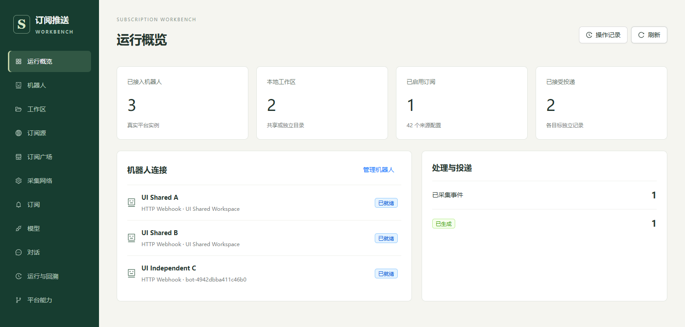

<div align="center">
  
  <h1>订阅推送工作台</h1>
  <p>把分散的更新变成可追溯的多平台订阅推送。</p>
  <p><strong>采集来源 · 分类订阅 · Agent 整理 · 独立投递 · 会话追问</strong></p>
  <p>
    <a href="#快速开始">快速开始</a> ·
    <a href="#能力与边界">能力与边界</a> ·
    <a href="docs/architecture.md">架构</a> ·
    <a href="docs/status.md">实现状态</a> ·
    <a href="https://github.com/ravicc02/subscription-workbench/releases">版本下载</a>
  </p>
</div>

---



这是一个**独立运行**的 Python 服务和 React 管理台，不依赖 AstrBot 进程。它将来源采集、工作区订阅、模型处理和机器人发送串成一条有证据的流水；一个工作区可以服务多个机器人，各机器人的目标与发送状态彼此独立。

```text
RSS / 网页 / JSON API / Webhook
       ↓ 基线、去重、错峰与冷却
分类 + 多标签订阅 → 工作区 → 直接 / 规则 / Agent 整理
                                 ↓
                       各机器人独立投递与回溯
                                 ↕
                         入站对话、历史推送检索
```

## 能力与边界

| 模块 | 当前支持 |
| --- | --- |
| 来源 | RSS / Atom、网页内容变更、公开 JSON API、带独立凭据的 Webhook；内置金融、科技、GitHub Hot 订阅包，可导入和导出规范 JSON。 |
| 订阅 | 一个工作区选一个大类和多个标签，动态纳入标签下的来源；相同来源只处理一次，首次仅建立历史基线。 |
| 处理 | 直接转发、固定格式规则或 Agent 整理；工作区选择处理模型和推送模板，任务保存规则快照与工具轨迹。 |
| 推送 | 微信个人、Telegram、飞书企业应用、Discord、Slack、OneBot v11、飞书/企业微信/钉钉群机器人及 HTTP Webhook 等已实现通道按目标独立记录状态；具体实测范围见下文。 |
| 对话 | 微信个人、Telegram、QQ 官方、飞书企业应用的文字及媒体输入；会话隔离，回复优先，共享受控模型并发。图片/视频抽帧需多模态模型，语音需平台转写或本地模型，回复仍为文字。 |
| 运维 | 独立管理登录、凭据加密、来源批量检查、采集代理、状态与运行记录。发送结果不明时不自动重发。 |

**重要限制：**QQ 官方机器人目前仅支持被动回复，不作为主动订阅快讯目标；QQ/飞书官方应用已通过隔离协议与会话链路测试，真实账号的权限、收发和飞书额度仍需现场验收。微信和 Telegram 的真实媒体入站也尚未完成用户端闭环。预置 40 个公开 RSS **不等于**它们当前全部可达；非 RSS 社媒连接器（如 X、抖音、小红书）目前只有[扩展方案](docs/source-connectors-plan.md)，尚未接入。细节及证据见[当前状态](docs/status.md)。

## 快速开始

需要 **Python 3.11+、Node.js 和 pnpm**；媒体抽帧/转码需另装 ffmpeg，离线语音转写需按[媒体指南](docs/media.md)安装本地模型。

```powershell
python -m venv .venv
.\.venv\Scripts\python.exe -m pip install -r requirements.txt
pnpm --dir web install --frozen-lockfile
pnpm --dir web build
.\start.ps1
```

打开 **http://127.0.0.1:6190**，首次进入设置管理员密码。默认只监听本机；如需经反向代理访问，应显式配置允许的 Host、认证和网络边界。

Linux/macOS 使用相同依赖安装步骤，并从项目根目录启动：

```sh
python -m uvicorn backend.app.main:app --host 127.0.0.1 --port 6190
```

### 首次配置

1. 在**模型**添加兼容 Chat Completions 的服务，Agent 用模型先通过工具调用能力检查；按需设置处理与对话模型。
2. 在**机器人**命名并选择类型，扫码或填写平台参数，选择独立/共享本地工作区。微信等通道可能需先收到一条消息才能确定目标。QQ/飞书应用的权限与目标发现见[接入说明](docs/qq-feishu.md)。
3. 在**订阅广场**同步公开来源包，或自行创建来源、分类与标签；在**订阅**为工作区选择大类和多个标签。同步来源包本身不会自动订阅或推送。
4. 在**工作区**检查推送模板与模型。新增内容进入处理队列；首次采集只建立基线，不补发旧条目。

来源页的“检查全部”是**实际采集**，遇到新事件可能触发真实推送。接入测试消息同样会发送到选定目标，请在合适的账号与时段使用。

## 工作区与数据

```text
backend/      服务、调度、平台通道与模型运行器
web/          React 管理台
packs/        内置订阅包
docs/         架构、当前能力、操作与扩展方案
state/        本地数据库、加密密钥、平台状态（不入库）
workspaces/   实际工作区和任务产物（不入库）
```

默认独立目录为 `workspaces/bots/<bot-id>/`，共享目录为 `workspaces/shared/`，也可绑定已登记目录。多个机器人绑定同一目录时共用订阅与整理产物，但每个机器人保留独立投递记录和会话上下文。

**备份时将 `state/` 的 SQLite 数据库与 `vault.key` 一起保留，并备份 `workspaces/`。**不要把 Token、登录状态、工作区或运行记录提交到 Git。修改通道目标会取消未发出的旧绑定任务；结果为 UNKNOWN 的投递不会盲目重发。

可选环境变量：`WORKBENCH_ROOT` 指定状态根目录；`WORKBENCH_WORKSPACE_ROOTS` 追加允许绑定的目录；`WORKBENCH_HOSTS` 限制访问的 Host；`WORKBENCH_ALLOWED_HOSTS` 明确允许私有地址外呼的主机。采集代理在管理台设置，Telegram 自动复用已保存的全局代理地址；其他通道与模型不受该设置影响。

## 开发与发布

```powershell
.\.venv\Scripts\python.exe -m pip install -r requirements-dev.txt
.\.venv\Scripts\python.exe -m ruff check backend tests scripts
.\.venv\Scripts\python.exe -m pytest -q
.\.venv\Scripts\python.exe scripts\build-release.py --check
pnpm --dir web build
.\.venv\Scripts\python.exe scripts\check-browser.py
```

浏览器验收使用隔离数据目录与本地 HTTP 接收端，不会向用户平台账号发送消息。推送 `main` 后 CI 运行静态检查、测试、前端构建和浏览器验收；`vX.Y.Z` 标签重复验证并生成 ZIP 与 SHA-256 文件。发布包不包含实例数据，也不会自动部署。流程见[发布指南](docs/releasing.md)，变更见[更新记录](CHANGELOG.md)。

**进一步阅读：**[架构](docs/architecture.md) · [当前状态](docs/status.md) · [订阅包规范](docs/subscription-package.md) · [对话与联网](docs/conversations.md) · [媒体支持](docs/media.md) · [QQ/飞书](docs/qq-feishu.md)
